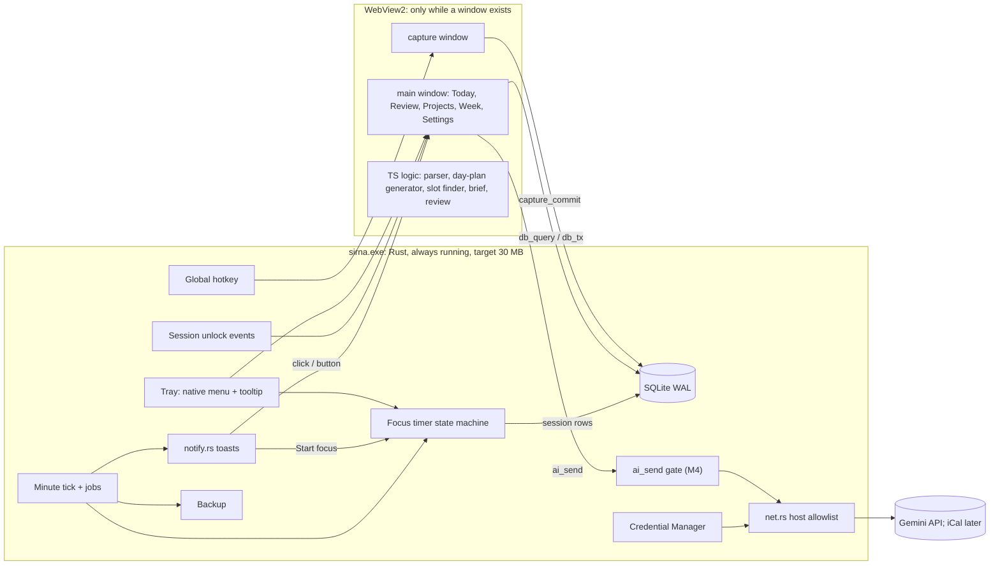

# Sirna: Architecture and Flow Plan

Version 3.1 · 2026-11-11 · name: Sirna (Oromo: order, system) · one user, one Windows 11 laptop

How to read this: §0 is all you need to start. Everything after it is reference. Read a section when its milestone starts (§13 names them).

**What changed from v2**
- The core is now **workload, routine, focus and burnout control** across your life areas, not finance and email.
- **Gmail integration is cut.** "Check email" blocks remind you to open Gmail yourself.
- **Bank/telebirr SMS is cut.** The night review asks what you spent today (mostly cash).
- **New:** life areas with weekly targets, a weekly routine, a day plan made of blocks, a focus timer (pomodoro), burnout rules, and projects with a timing check.
- **AI moves earlier** (M4 instead of M6). Its main job: argue whether a new project fits the date you picked, or find a slot when you gave none.
- **Privacy worry shrinks.** With no email or bank data, Gemini only sees task titles, area names, minutes and dates.

---

## 0. One-page summary

**What it is.** A small Windows tray app that plans your week across your life areas, tells you what to do now, runs your focus sessions, stops you before you burn out, and checks in with you morning and night. You type into one box. The app does all the math. Gemini argues about timing and phrases things; every change it makes can be undone.

**Your life areas** (defaults, editable)

| Area | Kind | Default weekly target | Notes |
|---|---|---|---|
| Job A | work | its fixed hours | Fixed blocks from your schedule |
| Job B | work | its fixed hours | Fixed blocks |
| Job hunt | growth | 4 h | Applications, CV, interview prep |
| Coding skills | growth | 4 h | Deliberate practice |
| Experiments | growth | 3 h, capped | Building tools like this one. Capped so it can't eat the week |
| Gym | health | 3 × 45 min | Protected |
| Quran | faith | 20 min a day | Protected |
| Life admin | admin | 2 × 15 min a day | Email checks, errands, money |

**The daily loop**

| Moment | Trigger | You do | Time |
|---|---|---|---|
| Capture | Ctrl+Alt+Space | Type one line, Enter | 5 s |
| Morning brief | First unlock after wake time | Read today's blocks and top 3, Enter = "Start my day" | 1 min |
| Block starts | Toast: "Coding · 45 min · first step: …" [Start focus] [Move] [Skip] | One tap | 2 s |
| Focus | Timer in the tray: 25 min work / 5 min break, long break after 4 | Work; the app calls the breaks | — |
| Email check | "Check email" block, 10:00 and 15:00 | Open Gmail yourself | 10 min |
| Night review | 21:00 toast | Tick blocks, say what you spent, rate energy 1–3, accept tomorrow | 3–4 min |
| Sunday | Sunday's review adds the week card | Area hours vs targets, load, projects | +5 min |

**Stack.** Tauri v2 + WebView2. A small Rust core lives in the tray (target ≤ 30 MB private bytes): tray menu, hotkey, minute tick, **focus timer**, toasts, session-unlock events, SQLite, migrations, backups, secrets, network (Gemini; later iCal). A React + TypeScript UI runs only while a window is open and holds the product logic: capture parser, day-plan generator, slot finder, brief, review. One SQLite file is the source of truth.

**Placement rule.** If it must happen with no window open (a toast, the focus timer, a backup), Rust does it, reading rows that already exist. Everything else is TypeScript.

### Build card (for Claude Code and you)

| M | Builds | Estimate / timebox | Fallback when the timebox runs out |
|---|---|---|---|
| M0 | Rust on D:, tray, hotkey → capture → one SQLite row, two-button toast in the installed build, tray tooltip timer, idle RAM | 5 h / 7.5 h | Stop measuring; take the safe option for each open check |
| M1 | Capture parser, tasks, notes, cash expenses, Today list, reminders, tray menu | 8 h / 12 h | Up-arrow edit waits (tray Undo stays) |
| M2 | Areas, weekly routine, day-plan generator, block toasts, focus timer. **Daily use starts** (~23 h) | 10 h / 15 h | Fixed 25/5 timer only; generator fills areas, not tasks |
| M3 | Morning brief, night review (spending, energy), burnout rules | 8 h / 12 h | Review steps 1 and 4 only |
| M4 | Gemini: projects, timing check, auto-slot, capture fallback | 10 h / 15 h | Slot finder without AI text |
| M5 | Sunday week card, dashboard (streak, year chart, savings plant) | 8 h / 12 h | Streak + year chart only; plant waits |
| M6 | Google Calendar (read-only), only if you have meetings outside the routine | 5 h / 7.5 h | Skip |
| M7 | Desktop mini widget (off by default) | 5 h / 7.5 h | Tray widget only |

**Hard rules**
1. A "can't use it" bug is fixed before any new work.
2. After 7 days of use, spend 10 minutes on 3 numbers (`pnpm usage`) and the `fb:` rows. Then build the top `fb:` row or the next milestone.
3. Every milestone ends with `pnpm ship` (the installed build) and at least one day of real use.

The questions to answer before M0: §16.

---

## 1. Goals, non-goals, success metrics

**Goals**
1. **You always know what to do now.** One "Now" item, from a day plan you didn't have to build.
2. **Easy start, hard stop.** Work happens in timed sessions. Starting is one tap; stopping is called by the app.
3. **Every area gets its time, within a sustainable load.** Jobs, job hunt, coding, gym, Quran: each week shows where time went.
4. **New ideas get an honest time check** before you commit to them.
5. **Nothing important lives only in your head.**
6. **Light on the machine:** ≤ 30 MB private bytes idle with no webview; DB ≤ 25 MB a year.

**Non-goals**
- No reading email, no bank or SMS integration, no cloud, no second user, no phone app in Stages 1–3.
- No guilt mechanics: the streak forgives (§3.13); nothing counts what didn't happen.
- No website or app blocking (cut list, §12.2).
- No flow that needs AI or the network to work.

**Success metrics** (from `core_usage`, trailing 14 days; away days left out). They steer what to build next; they lock nothing.

| Metric | Definition | Target |
|---|---|---|
| StartDay | "Start my day" pressed before 13:00 | ≥ 10 of 14 |
| ReviewDay | Review step 1 answered | ≥ 10 of 14 |
| FocusDay | At least 2 focus sessions completed | ≥ 10 of 14 |
| Area coverage | Areas reaching ≥ 70% of weekly target | ≥ 5 of 7 areas |
| Overrun days | Days past the focus cap or hard stop | ≤ 2 a week |
| Energy | Average evening energy (1–3) | ≥ 2 |
| Block nudges ignored | Start nudges with no action ÷ shown | < 50% |
| Idle footprint | Private bytes, tray only | ≤ 30 MB |

---

## 2. Design principles

1. **One place to type.** Every extra field is a reason to skip a day.
2. **Enter accepts the default.** Low-focus days still count.
3. **Three priorities, never more.** The rest collapses into "+2 more".
4. **Easy start, hard stop.** The app lowers the cost of starting (first step, one pomodoro) and owns the stopping (breaks, cap, hard stop).
5. **Rest is planned, not earned.** Breaks, a rest day, and gym/Quran blocks are protected; work never takes them automatically.
6. **Load before commitment.** A new project is checked against your real free time before it lands.
7. **Progress you can see, misses that don't hurt.** A forgiving streak, a year chart and a growing plant show progress; rest days, away days and one miss a week never break anything. Guilt causes avoidance.
8. **The app calculates, the AI explains.** Capacity, load and slots are code. The AI argues and phrases. Every AI change can be undone.
9. **Works without AI or network.**
10. **Nothing runs that doesn't need to.** No webview without a window, no AI in the background.

---

## 3. User flows

### 3.1 First-run setup (about 5 minutes)

1. **Hotkey practice:** "Type something you need to do tomorrow." It becomes a real task.
2. **Your day:** wake time (default 06:00), hard stop (default 22:30), review time (default 21:00).
3. **Your jobs:** for each job, days and hours. Becomes fixed blocks.
4. **Your areas:** the defaults from §0, each with a target. Untick any you don't want now.
5. **Launch at startup** (checked; one click). "Drag the tray icon out of the ^ overflow."

The app then generates tomorrow's plan, so the first brief is not empty. Further setup (prayer-time anchors, gym days, a first project) arrives as one "Setup, 1 min" line at the top of the brief, at most one a day.

### 3.2 The weekly routine

A routine is a template of blocks per weekday. The app ships one built from your setup answers; you edit it rarely (Sunday card). Example, with placeholder job hours until you answer §16:

| Time | Mon–Fri | Sat | Sun |
|---|---|---|---|
| 06:00–06:20 | Quran | Quran | Quran |
| 08:00–12:00 | Job A (fixed) | Coding 2 × 50 min | Rest day |
| 12:00–13:00 | Lunch + break | — | — |
| 13:00–17:00 | Job B (fixed) | Experiments 90 min | — |
| 10:00 and 15:00 | Check email, 10 min | — | — |
| 17:30–18:15 | Gym (Mon, Wed, Fri) / Job hunt 45 min (Tue, Thu) | Gym | — |
| 19:00–20:30 | Area block (generator fills it) | Job hunt 60 min | Sunday week card |
| 21:00 | Night review | Night review | Night review |
| 22:30 | Hard stop | Hard stop | Hard stop |

Block kinds: `fixed` (jobs, calendar), `routine` (Quran, gym, email checks, protected), `area` (filled by the generator), `rest`.

### 3.3 Day-plan generation (deterministic TypeScript)

Runs when the night review accepts tomorrow, and again at the first unlock if nothing was accepted.

1. Copy the weekday's template: fixed and routine blocks first.
2. Mark light days: if the last two energy ratings were 1, or tomorrow is the rest day, keep only fixed and routine blocks plus one top task.
3. Fill `area` blocks by **weekly deficit**: the area furthest behind its target (as a share) gets the next free block, respecting the priority order below and the Experiments cap.
4. Assign tasks into blocks by area: deadline first, then the project's next step, then oldest.
5. Leave 20% of free time unplanned as buffer.
6. Pick the top 3: last night's choice → deadlines within 48 h → the focus project's next step → the most behind area's task.

**Default priority order** (a setting): 1 deadlines within 48 h · 2 job duties · 3 job hunt · 4 gym and Quran (protected: never dropped for work) · 5 coding skills · 6 experiments. Job hunt sits high because it is the change you want; experiments sit last and capped because they pull you in.

### 3.4 Morning brief

**Trigger.** First session unlock or login after wake time, before 13:00 (Windows `WTS_SESSION_UNLOCK`). Already unlocked before wake time → a "Brief ready" toast at 07:30. Full-screen or presentation → the toast instead. After 13:00 nothing pops; Today still shows it.

**Rules.** At most 12 lines. Empty sections are hidden. No questions.

```
Wednesday 11 Nov                                       06:46
NOW        Quran · 06:00–06:20
TOP 3
☐ Send weekly report (Job A)            due today
☐ Apply: Backend dev at Kifiya           (Job hunt, 45 min)
☐ Portfolio site: About page             (Experiments, 1 pomodoro)
TODAY      08–12 Job A · 13–17 Job B · 17:30 Gym · 19:00 Coding 2×25
LOAD       6 h 10 planned of 7 h free · light-ish
THIS WEEK  Job hunt 1 h 30 / 4 h · Coding 2 h / 4 h · Gym 1 / 3
                                          [Start my day ⏎]  [Swap one]
```

From M4 Gemini may add one line in a fixed slot under the numbers, e.g. "Job hunt is furthest behind; today's evening block is for it."

### 3.5 Capture

**Trigger.** Ctrl+Alt+Space (configurable). Enter saves at once. The box shows the echo for 1.5 s, then hides. Up arrow recalls the last capture to edit; Ctrl+Z undoes it; the tray shows "Last: … · Undo".

| You type | Saved as | Echo |
|---|---|---|
| `call recruiter tomorrow 10am` | Task · Thu 10:00 · reminder · Job hunt | Task · Thu 10:00 · Job hunt |
| `fix login bug #jobA` | Task · Job A | Task · Job A |
| `lunch 120` | Cash expense · Food | 120 ETB · Food |
| `idea: build a CLI budget tool by 20 dec` | Project idea with a date → timing check (§3.8) | Checking the timing… |
| `idea: learn Go` | Project idea, no date → slot finder (§3.8) | Finding a slot… |
| `focus` | Starts a focus session on the current block | Focus 25:00 |
| `gym done` | Marks today's gym block done | Gym ✓ |
| `fb: brief too long` | Feedback note | Feedback |
| `? kifiya` | Search; nothing saved | matches |
| `away till mon` | Away mode | Away until Mon 16 Nov |
| `something about the car` | Inbox note | will ask tonight |

**Parser** (deterministic TypeScript in `src/capture/`): prefixes win (`t:` `n:` `idea:` `fb:` `?` `#area` `focus` `away`); money = `label amount [etb|br|birr]`; dates by chrono-node's `en.GB` parser (reads `12/11` as 12 Nov) plus custom rules; "at 3" with no am/pm follows a one-time setting (09:00 Ethiopian clock or 15:00); area from `#tag`, else from words in area and project titles, else Life admin; no match → inbox note.

### 3.6 Focus sessions

**Start.** From the block toast [Start focus], the tray menu, the brief, or typing `focus`. The session belongs to the current block's area and its first task.

**The timer lives in Rust** (no webview needed). The tray tooltip shows `Focus · Coding · 18 min left`; the tray menu shows [Pause] [Stop] [Distracted].

| Event | What happens |
|---|---|
| Work period ends (default 25 min) | Toast: "Break · 5 min. Stand up, water." [Start break] [+5 min work, once] |
| Break ends | Toast: "Next session?" [Start 25] [Done with this block] |
| 4 sessions in a row | Long break, 20 min. Starting earlier needs a second tap ("Start anyway"). |
| Block's time is up | Toast: "Block over. Wrap up in 5 min." The next block's toast follows. |
| [Distracted] | Logs one tick on the session; no penalty. The night review shows the count only if it helps ("3 distractions in the 19:00 block, try a shorter session?"). |

Session length is a setting per area (25/5 default; 50/10 for deep work). Job blocks run the timer only if you start it.

**Start-friction help.**
- Every block toast names a first step of ≤ 5 minutes (the task's first line, or "open the file").
- If a block started 10 minutes ago with no session: one nudge, "Just one 25-minute session on Coding?" [Start 25] [Move block] [Skip]. One nudge per block, never more.
- "Move block" offers the next free slot today; if none, tomorrow.

### 3.6a Focus set-up (the environment)

When a session starts, a small set-up sheet (capture-sized window) shows for a few seconds. Enter starts the timer; everything on it is pre-filled from the area's **focus kit**, so a normal start is one key.

| Step | How | Auto or tick | Undone at session end |
|---|---|---|---|
| "This session I will…" | One optional line; shown in the tray and asked about at the end ("Done?") | Optional | — |
| Do Not Disturb on | Windows 11 has no documented API to switch DND. M3 tests, in order: (1) an undocumented WNF state write; (2) opening Windows' own Focus session; (3) fallback: the sheet shows "Turn on Do not disturb (Win+N)" as a tick. **Unverified.** The app's own toasts are held during focus anyway, except breaks. | Auto if (1) or (2) works | Yes, restored to what it was |
| Minimize distracting apps | A list per kit (e.g. Telegram, the browser). Minimized via Win32 `ShowWindow(SW_MINIMIZE)`; never closed | Auto | Optional restore |
| Open the work | Per kit: a folder in VS Code, files, URLs (CV, job board, docs), the Quran app | Auto | No |
| Sound | Optional: mute system sounds, or open a focus playlist/ambient URL | Auto if set | Yes |
| Phone away | "Phone in another room / face down" | Tick (never blocks) | — |
| Water | "Water on the desk" | Tick | — |
| Break content | Break toasts rotate: stand up, water, look 20 m away for 20 s, stretch | — | — |

- Per-area defaults: Coding kit opens VS Code and docs; Job hunt opens the CV folder and job board; Quran kit opens the Quran app and nothing else; Gym kit has no screen steps.
- Never: closing apps, editing the hosts file or anything needing admin, blocking websites (cut list: comes back on a distraction trigger).
- Session end: "Done with: finish the login form?" [Yes] [Partly] [No]. That answer feeds the review's step 1.

### 3.7 Burnout guard

| Rule | Default | What the app does |
|---|---|---|
| Breaks | 5 min after each session; 20 min after 4 | Called by toast; early start needs a second tap |
| Daily focus cap (outside job blocks) | 4 h | At the cap: "That's 4 h. Stop here; tomorrow is planned." Later sessions are allowed but marked overrun. |
| Hard stop | 22:30 | Toast: "Hard stop. Good day." The tray shows "Stopped for today"; new sessions need a second tap. |
| Weekly load | ≤ 85% of free time | Adding work past it triggers the timing check (§3.8) |
| Active personal projects | At most 2 (outside jobs) | A third goes to "Next up" until one finishes or pauses |
| Experiments | Capped at its weekly target | Past the cap, its blocks go to the most-behind area |
| Energy | Asked each night, 1–3 | Two 1s in a row → tomorrow is a light day (fixed + routine + one task) |
| Rest day | One a week (default Sunday) | No area blocks; Quran and the week card only |
| Overrun pattern | 3 overrun days in a week | The week card suggests pausing a project or lowering a target |

None of these block you. They make stopping the default and continuing a deliberate second tap.

### 3.8 Ideas and projects: the timing check

A **project** has: title, area, goal, estimate (hours; the AI suggests one if you don't), deadline (optional), weekly hours, next step, status (`idea | next_up | active | paused | done | dropped`).

**The app calculates first** (TypeScript, no AI):
- Free capacity per week = template free time − fixed − routine − 20% buffer.
- Committed per week = sum of active projects' weekly hours + area targets.
- For a requested date: hours needed ÷ weeks left = weekly hours required → load % for each week.
- Without a date: the **slot finder** walks forward week by week, giving the project min(remaining, capacity left under 85%) each week, and returns the earliest start and finish. It respects the 2-active-projects limit (if full, the start is when the earlier project's finish is forecast).

**With a date** (`idea: build a CLI budget tool by 20 dec`), the card shows the app's numbers and Gemini's reasoning:

```
CLI budget tool · by Sat 20 Dec · estimate ~18 h (AI)
Needs 3 h 15 a week for 5.5 weeks. Your load would go 78% → 96%.
TIGHT
 · It competes with Job hunt, which is already 40% behind this month.
 · Two active projects already; this would be a third.
 · Your energy averaged 1.6 last week.
Suggest: start after Portfolio site finishes (~29 Nov), finish ~10 Jan.
   [Use suggested dates]  [Keep 20 Dec, pause Portfolio]  [Smaller scope]  [Drop]
```

Verdicts: **Good** (load stays ≤ 85% and limits hold) · **Tight** (≤ 100% or a limit breaks) · **Too much** (> 100%). The verdict comes from the numbers; Gemini only writes the reasons and alternatives, from a fact sheet (§7).

**Without a date** (`idea: learn Go`): the slot finder places it and **adds it by itself**: it becomes `next_up` or `active` with weekly blocks in the plan. The echo says "Learn Go · starts Mon 24 Nov · 2 h/week · ~6 weeks [Undo] [Change]". Nothing else to approve.

Without AI (no key, offline, quota): the same card with numbers and a template reason ("Load would reach 96%").

### 3.9 Night review

**Trigger.** 21:00 toast [Start] [In 30 min] [Skip tonight]. Locked or asleep → toast at the next unlock before hard stop. Stays in the tray menu until 03:00. Never opens by itself.

| Step | Shows | Default if you close it |
|---|---|---|
| 1 Today | Blocks and top 3 with ticks; focus sessions done; [All the rest to tomorrow]. One question at most, for an item on its 3rd carry: "Make it smaller?" [Smaller] [Someday] [Keep] | Unanswered = unknown; it carries without counting |
| 2 Spending | "What did you spend today?" Type `lunch 120, taxi 40` (commas split) or [Nothing]. Today's typed expenses are listed above. | Nothing logged |
| 3 Energy | "How was your energy?" [1 drained] [2 okay] [3 good] | Not recorded |
| 4 Tomorrow | Tomorrow's blocks and top 3 [Looks good] [Swap one]; "Anything on your mind?" (optional) | The app's plan |

At most 7 taps on a normal night. **Skip tonight** counts against nothing. Up to 2 inbox notes appear in step 1 as [Task] [Note] [Drop].

### 3.10 Sunday week card (M5)

1. **Where time went:** hours per area vs target (bars), focus sessions, overrun days.
2. **Load next week:** planned vs free, with the light days marked.
3. **Projects:** each active project's progress vs estimate and forecast finish; [Keep] [Pause] [Done]. Next-up projects that can start.
4. **Money:** this week's spending by category, vs your 4-week average.
5. **One change:** the app proposes one routine tweak from the data (e.g. "Job hunt hit target only when it was before 18:00. Move it?") [Apply] [No].

From M4, Gemini writes a short paragraph for card 1, grounded in the numbers.

### 3.11 Away and missed days

| Situation | What happens |
|---|---|
| Review missed | Nothing marked. The next brief shows yesterday's unfinished top 3 with tick boxes, and the plan is regenerated. |
| First unlock after 13:00 | No pop-up. Today shows the plan for the rest of the day. |
| Reminders missed during sleep | ≤ 15 min late: normal toast. Later: one summary toast. Older than 12 h: listed in the brief. |
| `away till mon` | Brief, review, block toasts pause. On return, a fresh plan. |
| No unlock for 2+ days | Overdue dated tasks move to Someday; one collapsed line in the brief. Area targets for the missed days are dropped, not carried. |

### 3.12 Money, kept simple

Cash spending from capture and the night review, by category. Today shows nothing about money. The Sunday card shows the week; the month's first Sunday adds last month by category. No balances, no accounts beyond "cash" (and optional others you add). Budgets, bills and bank data wait on the cut list.

---

### 3.13 Dashboard: streak, year chart, savings plant

One screen (tray → Dashboard; also the top of the Sunday card).

**Focus streak (with the flame).**
- A day counts if it has at least 2 completed focus sessions **or** all its protected routines (Quran, gym when scheduled) done.
- **Never breaks on:** the rest day, away days, light days (one session is enough), and **one free miss a week** (shown as "1 free miss left this week").
- When it does break, the screen shows "Best: 21 days · current: 1" with no red, no message. Toasts never mention the streak.
- Shown small in the brief header; big on the dashboard.

**Year chart (GitHub-style dots).** 52 × 7 cells, one per day, shade = focus minutes (0, < 1 h, 1–2 h, 2–3 h, 3 h+). Filter by area (e.g. only Quran, only Job hunt). Rest and away days show as a faint outline, not empty. Tap a day for its blocks and sessions.

**Savings plant.**
- You set one or more savings goals ("Laptop · 100,000 ETB").
- Saving is logged by capture (`saved 500` or `saved 500 laptop`) or by a Sunday question: "Put anything aside this week? [No] or type".
- The plant has 6 stages (seed → sprout → small plant → bushy → flowering → tree) by % of the goal. It **never wilts or dies**; withdrawals (`took 2000 from laptop`) only lower the number. A finished goal becomes a tree in a small "garden" row.
- Saving is the only money number on the dashboard; it is tracked separately from spending.

**Area bars.** Hours this week vs target per area (the same numbers as the Sunday card).

### 3.14 From the inspiration shots (2026-11-11)

**Features taken**

| From | Idea | Where it lands | M |
|---|---|---|---|
| Prodly (focus analytics) | Stat tiles with tick-bar meters: focus time vs goal, break time, distractions + most common cause | Dashboard top row | M5 |
| Prodly | Horizontal timeline with a "now" marker; past blocks faded; current block highlighted | Today | M2 |
| Prodly | Insight cards: "Best focus window: before noon", "Use 2 sessions before Job B" | Sunday card + one in the brief; computed from `focus_sessions`, Gemini phrases them | M5 |
| Neura (planner) | One colour per area on every block, chip and bar | Everywhere | M2 |
| Neura | Countdown card: "Gym in 48 min" | Today, under Now | M2 |
| Neura | Weekly bars per day with hover detail | Dashboard | M5 |
| InBoard (email accountability) | **Waiting on others**: a task can be `waiting` with who and a follow-up date ("waiting on recruiter, follow up Mon"); a reminder fires on that date | Capture (`wait: recruiter reply mon`), review, Projects | M3 |
| InBoard | **At risk**: deadlines whose planned time before the date is less than the estimate | Brief line + Projects | M4 |
| InBoard | "What changed since yesterday" (new captures, moved items, finished) | One brief line | M3 |
| Mamuku (manual finance) | **One-tap expense templates**: chips for repeats ("Taxi 40", "Lunch 120") learned after 3 repeats | Night review spending step + capture suggestions | M3 |
| Mamuku | Spending pace: this month's running total vs last month | Sunday money card | M5 |
| Mamuku | Accent colour / theme picker | Settings | M5 |
| Mamuku | Friendly illustration style | Savings plant, empty states | M5 |
| Budglee (budget planner) | "On track · 58,000 left" card with one bar | Savings goal card on the dashboard | M5 |
| Budglee, Cazura | Day / Week / Month / Year toggle | Dashboard and spending views | M5 |
| Cazura (finance) | Bubble chart for spending by category | Sunday money card | M5 |
| Taskflow (kanban) | Project page as a board: To do / Doing / Waiting / Done, with a List tab | Projects | M4 |

**Not taken:** card/bank visuals, subscriptions, transaction tables, avatars and team features, bulk entry and CSV import (cash-first), an "Ask AI" chat (cut list), draggable widget layouts (later, if the default layout gets in the way).

**Visual direction**
- **Dark by default** (Prodly): near-black surfaces, one bright accent (lime) for "now" and primary actions. Most use is early morning and evening.
- **Light theme** (Taskflow / InBoard): warm off-white, soft cards. Both come from the same CSS tokens from M1, so the switch is free.
- **Area colours** carry meaning (Neura); the accent is reserved for Now and the primary button.
- **Bento layout**: rounded cards in a grid, a narrow icon sidebar (Today, Focus, Projects, Dashboard, Week, Settings).
- **Restraint**: one primary button per screen; numbers large, labels small; no gradients behind data.

### 3.15 Cheat sheets (short, pinned notes)

A cheat sheet is a short card you keep coming back to: not a journal. Examples: "Git commands I forget", "My elevator pitch", "Gym routine A/B", "Where I am in the Quran", "Job B logins and contacts" (no passwords).

- **Add from anywhere:** `pin: git undo last commit = git reset --soft HEAD~1 #coding` appends a line to that area's sheet (or a sheet named after the `#tag`). `pin:` with no tag goes to "General".
- **Where they show:** a Notes page (one column of cards per area); the focus set-up sheet shows the current area's card next to the timer; `? reset` searches them; the desktop widget (§3.16) can pin one card.
- **Kept short on purpose:** each card is Markdown, titled, at most ~25 lines. Past that the app suggests splitting it. Untouched for 90 days → listed once in the monthly clean-up ("Still useful?").
- **Never sent to Gemini** unless you open "Ask" (cut list).
- Stored as `note_items(kind='cheat', title, area_id, body, sort_order)`; edits are versioned in `core_activity`, so an overwrite can be undone.

### 3.16 Widgets

Three kinds, cheapest first:

| Kind | What | Cost | When |
|---|---|---|---|
| **In-app widgets** | The dashboard is a grid of cards (focus tiles, streak, year chart, savings plant, a cheat sheet, area bars). Drag to reorder, hide, resize S/M/L. Layout saved in settings. | None extra | M5 |
| **Tray widget** | The native tray menu already shows Now, the timer and the top 3 with no webview (§4.1). | None | M2 |
| **Desktop mini widget** | A small frameless window you place on the desktop: Now + timer ring + top 3, optional cheat sheet below. Not always-on-top by default; hides when an app is full-screen. | One webview while shown (~60–100 MB, unmeasured) | M7, **off by default**; turned on in Settings after M0's numbers are known |
| Windows 11 Widgets board (Win+W) | A Sirna card in Windows' own widget panel | Needs a packaged (MSIX) app and a COM widget provider. **Unverified with Tauri.** | Cut list |

The desktop widget reads the same views as Today (`v_today`) and refreshes on `data-changed`. It is a second window, so it is destroyed when switched off and measured like `main` (§10).

---

## 4. System architecture

### 4.1 Process model



Carried from v2 (unchanged; see the decision log):
- **No webview at startup** (`"windows": []`); windows are created on demand and destroyed on close.
- **Stay alive with no window:** `prevent_exit()` only when `RunEvent::ExitRequested` has `code: None`; tray Quit calls `app.exit(0)`.
- **One instance** (`tauri-plugin-single-instance`, registered first). Autostart passes `--autostart` = tray only.
- **One async window opener:** windows built inside a sync command or event handler deadlock, so every caller spawns `open_window(..)`.
- **Small runtime:** tokio with 2 worker threads set once via `tauri::async_runtime::set`.
- **`panic = "unwind"`**, DB behind `parking_lot::Mutex`.
- **Live refresh:** Rust emits `data-changed {tables}` after each write.

**Native tray menu** (no webview): Now: current block · [Start focus] or the running timer with [Pause] [Stop] [Distracted] · today's top 3 as check items · Capture… · Today · Projects · Night review (after 21:00) · Last capture · Undo · Away… · Quit. Tooltip: `Focus · Coding · 18 min left` or `Next: 17:30 Gym` (≤ ~127 characters).

### 4.2 The focus timer (Rust)

State machine: `idle → focusing → break → (focusing | idle)`, plus `long_break` and `paused`. State is persisted in `focus_sessions` on every transition, so a crash or sleep resumes correctly:
- Wall-clock based. After sleep, an elapsed work period ends with the normal break toast; if more than 30 min passed, the session closes as `interrupted` and no break is forced.
- Breaks after 4 sessions in a row become long. "In a row" = gaps under 15 min.
- The focus cap and hard stop are checked on each transition, not by polling.
- Optional later: pause when no keyboard/mouse input for 5 min (`GetLastInputInfo`). Cut list.

### 4.3 Window lifecycle

| Window | Style | Created | On hide or close |
|---|---|---|---|
| `capture` | 560×72, frameless, on top, not in taskbar | First hotkey | One mode picked in M0: destroy if cold p95 ≤ 700 ms, else hide + `TrySuspend` |
| `main` | 1040×720 | Brief trigger, tray, toast click, second launch | Destroyed on close |

**Unverified:** whether closing a window frees WebView2 memory (a 2022 report, Tauri #5397, says not on Windows 10). M0 measures it. If not freed: Fallback 1 the same evening (keep `main` hidden and suspended); Fallback 2 (the core restarts itself with `--autostart` when idle with no window).

### 4.4 Feature folders

No registry until the 5th feature. Until then, a folder convention:

| Rule | Detail |
|---|---|
| Folder | `apps/desktop/src/features/<id>/`: `migrations/*.sql`, `queries.ts`, `capture.ts`, `brief.tsx`, `review.tsx`, `fixtures/` |
| Tables | Prefixed with the feature id. Others read them through `queries.ts` or views. |
| Reminders | A feature that toasts ships `v_reminders_<id>` (`key, fire_at, kind, title, body, route, actions, counts_toward_cap`). Rust unions them. |
| Writes | Your captures and answers: direct, with undo. AI changes: direct with `actor=ai:<call_id>` and undo, or a proposal row where the card asks you. |
| Budgets | The shell caps the brief at 12 lines and the review at 7 taps. |

### 4.5 IPC surface

| Command | Callers | Does |
|---|---|---|
| `capture_commit(raw_text, ops)`, `capture_undo(raw_id)` | capture, main | Raw item + rows + activity in one transaction |
| `db_query(sql, params)` | both | Read-only connection |
| `db_tx(actor, context, ops[])` | main | Table/column allowlist; sets `updated_at`, `user_edited_at`; writes `core_activity` before/after JSON. No raw SQL writes. |
| `focus_start(block_id?)`, `focus_control(action)` | main, tray, toast | The Rust timer |
| `secret_set`, `secret_status` | main | No `secret_get` |
| `ai_send(request)` | main (M4) | The AI gate (§7) |

Permissions: `build.rs` declares commands; `src-tauri/capabilities/*.json` scopes them per window (capture gets only `capture_*`, `focus_start` and `db_query`); `removeUnusedCommands: true` under `build` in `tauri.conf.json`.

---

## 5. Data model

### 5.1 Rules fixed from day one

1. **Store first, parse second.** Every capture lands unchanged in `core_raw_items`.
2. **Every change has an actor** in `core_activity` (`user`, `system`, `rule:12`, `generator`, `ai:55`).
3. **Money is integer santim** (ETB × 100). Instants are UTC epoch ms. Dates are local `YYYY-MM-DD` in Africa/Addis_Ababa (UTC+3, no DST). Durations are minutes.
4. **One logical day, starting 03:00 local.** One function, `logicalDate(now)`, everywhere. The clock is injected for tests.
5. **User edits win.** Regeneration never overwrites a row or block you edited (`user_edited_at`).
6. **IDs:** ULID text for user rows, INTEGER for logs. `created_at, updated_at, deleted_at` on user tables.
7. **No secrets in SQLite.**

Pragmas: `journal_mode=WAL`, `synchronous=FULL`, `foreign_keys=ON`, `busy_timeout=5000`, `auto_vacuum=INCREMENTAL`.

### 5.2 Schema

`id, created_at, updated_at, deleted_at` omitted on user tables.

```sql
-- kernel (M1)
core_migrations(name PK, checksum, applied_at)
core_settings(key PK, value_json, updated_at)
core_job_runs(id INTEGER PK, job, occurrence_key, started_at, finished_at, status, error_code,
  UNIQUE(job, occurrence_key))
core_raw_items(id INTEGER PK, source /*capture|ics_event*/, source_uid, content_hash, received_at,
  body, meta_json, parse_status, parser_id, parser_version, parsed_at, error)
core_activity(id INTEGER PK, at, actor, context, entity_type, entity_id, action,
  before_json, after_json, INDEX(entity_type, entity_id, at))
core_rules(id PK, kind /*area_link|category|capture_kind*/, field, match, pattern, target, origin, hits)
core_notifications(key PK, kind, fired_at, counted, outcome, outcome_at, snoozed_until)
core_usage(id INTEGER PK, at, logical_date, event, props_json)      -- never leaves the machine
core_reviews(id PK, kind /*brief|evening|weekly*/, logical_date, started_at, step_reached,
  completed_at, skipped, taps, energy /*1..3, evening only*/, facts_json, UNIQUE(kind, logical_date))

-- tasks and notes (M1)
task_items(id PK, title, notes, first_step, status /*todo|waiting|done|dropped|someday|archived*/, waiting_on, follow_up_date,
  due_date, due_at, remind_at, estimate_min, area_id, project_id, carries, origin,
  completed_at, user_edited_at, INDEX(status, due_date), INDEX(area_id, status))
task_daily_top(logical_date, position /*1..3*/, task_id, chosen_by, PK(logical_date, position))
note_items(id PK, kind /*note|idea|inbox|feedback|cheat*/, status, title, body, area_id, sort_order,
  project_id, INDEX(kind, status))

-- money, cash-first (M1)
money_templates(id PK, label, amount_minor, category_id, uses)   -- one-tap chips, learned from repeats
money_categories(id PK, name, kind /*expense|income*/)
money_txns(id PK, account /*default 'cash'*/, occurred_at, local_date, amount_minor /*signed*/,
  description, category_id, origin, user_edited_at, INDEX(local_date), INDEX(category_id, local_date))

-- routine, plan, focus (M2)
area_items(id PK, name, kind /*work|growth|health|faith|admin*/, color, weekly_target_min,
  target_unit /*minutes|sessions*/, target_sessions, cap bool, protected bool, priority_rank,
  focus_min, break_min, active)
routine_blocks(id PK, weekday /*1..7*/, start_min, duration_min, kind /*fixed|routine|area|rest*/,
  area_id, title, active)
day_blocks(id PK, logical_date, start_at, end_at, kind, area_id, task_id, project_id, title,
  source /*template|generator|user|ai*/, status /*planned|started|done|skipped|moved*/,
  light_day bool, user_edited_at, INDEX(logical_date))
focus_sessions(id PK, block_id, area_id, task_id, kind /*focus|break|long_break*/,
  started_at, planned_min, ended_at, outcome /*completed|stopped|interrupted*/,
  distractions, overrun bool, INDEX(started_at))

-- focus kits, streak, savings (M3 / M5)
focus_kits(id PK, area_id, minimize_apps_json, open_items_json /*folders, files, urls, apps*/,
  dnd bool, sound_json, checklist_json, session_min, break_min)
-- focus_sessions also gets: intent_text, intent_done /*yes|partly|no*/
streak_days(logical_date PK, counted bool, reason /*sessions|routines|rest|away|light|free_miss*/)
savings_goals(id PK, title, target_minor, start_date, status /*active|done|paused*/)
savings_entries(id PK, goal_id, occurred_at, amount_minor /*signed*/, origin)

-- projects (M4)
project_items(id PK, title, area_id, goal, estimate_min, estimate_by /*user|ai*/, deadline,
  weekly_min, start_date, forecast_finish, status /*idea|next_up|active|paused|done|dropped*/,
  next_step_task_id, last_check_json /*verdict, load numbers, reasons*/)

-- calendar (M6, optional)
cal_events(...), cal_occurrences(...)   -- schema in Appendix A
```

M4 also adds `core_ai_calls(task, model, prompt_version, started_at, latency_ms, quota_day, tokens_in, tokens_out, status, error, request_redacted, response_text)`.

**Views**

| View | Gives |
|---|---|
| `v_today` | Blocks, top 3, the current "Now" block |
| `v_area_week` | Minutes per area this week (done focus + done blocks) vs target |
| `v_load_week` | Free vs planned minutes per day, next 14 days |
| `v_spend_daily` | Spending per day and category |
| `v_reminders_task` | Timed tasks |
| `v_reminders_block` | Block starts, start nudges, email checks, hard stop |

### 5.3 Pipeline, migrations, backups

- **Raw → record:** capture → `core_raw_items` → TS parser → records + activity in one transaction; no match → inbox note. Parsers carry id + version; a re-parse never overwrites user edits.
- **Migrations:** forward-only SQL per feature, numbered globally, embedded by `build.rs`, applied by Rust at startup after a `VACUUM INTO` backup; checksums in `core_migrations`; Vitest runs the same files on in-memory `node:sqlite`.
- **Backups:** after the night review (else at startup if > 24 h old) and before each migration: `VACUUM INTO` → `PRAGMA quick_check` → rename; 14 daily copies on `D:\Sirna\backups`; written restore in `docs/smoke.md`; brief alarm if the newest is > 3 days old. Never put the live DB in a OneDrive/Drive folder.

---

## 6. Inputs

| Input | How | When |
|---|---|---|
| Capture box | §3.5 | M1 |
| Night review answers | Spending, energy, ticks, tomorrow | M3 |
| Focus timer | Session rows | M2 |
| Email | **Not integrated.** "Check email" routine blocks at 10:00 and 15:00 remind you to open Gmail. Reading Gmail locally would not send it to Google's AI, but it is not needed for what you want. | — |
| Bank / telebirr | **Not integrated.** Cash first, via the review. | — |
| Google Calendar | Secret iCal address, read-only, fetched in Rust, parsed with ical.js (full design and failure codes in Appendix A) | M6, only if you have meetings outside the routine |

---

## 7. AI layer (M4)

### 7.1 Where it runs

```
React screen → task module (prompt, zod schema, validate, ground, fallback)  [TS]
            → provider adapter                                              [TS]
            → invoke("ai_send")                                             [Rust, ~150 lines]
              key from Credential Manager · host allowlist · pacing · daily budget · core_ai_calls row
```

- AI runs only while `main` is open, started by the screen that needs it. Nothing calls the model in the background.
- AI text renders in a fixed slot under the numbers; if it is not back within 4 s, the card shows the template text and fills in when ready.
- No Google SDK; the key never reaches the webview.
- **Facts, not tools.** The app sends a fact sheet and gets typed JSON back. Each tool round trip would cost a request on a tight free quota, and fact sheets are easier to test.
- Model: listed and picked at key entry (a Flash-Lite model), ID in config, never in code. A "model not found" error is a visible System line with [Pick again]. Exact model names and API surface are re-checked when M4 starts; Appendix C holds the research notes.

### 7.2 Provider abstraction

```ts
interface LlmProvider {
  id: "gemini" | "mock" | "openai-compat";
  privacyTier: "free-may-train" | "paid-no-train" | "local";
  generate(req: LlmRequest): Promise<LlmResult>;
}
```

Features call `runTask(taskId, input)`. Schemas: zod → flat JSON Schema (type, properties, required, enum, items, min/max); every reply is re-validated with zod. Adapters: `gemini` and `mock` (recorded outputs for tests).

### 7.3 Touchpoints

| Touchpoint | Sends | Returns | Fallback | Req/day |
|---|---|---|---|---|
| **Timing check** (§3.8) | Idea text; the app's numbers (estimate, weekly need, load % by week, active projects + forecasts, area deficits, last 7 energy ratings) | `{estimate_h?, reasons[≤3], alternatives[≤3]{label, start, finish, action}}` | Numbers + template reason | 0–3 |
| **Estimate** (no estimate given) | Idea text, area, similar past projects' actual hours | `{estimate_h, confidence, assumptions[≤2]}` | Ask: S / M / L (5 / 15 / 40 h) | inside the above |
| **Brief line** | Today's blocks (area + minutes), top 3 titles, area deficits | `{line ≤ 20 words}` | None shown | 1 |
| **Week paragraph** (M5) | Area hours vs targets, overrun days, energy trend, project progress | `{paragraph ≤ 80 words, one_change}` | Template sentence | 1 a week |
| **Review free text** | One answer the rules could not parse | `{reply, proposals[]}` | Saved as a note | 0–2 |
| **Capture fallback** | Pending inbox notes, area and project titles | `[{ref, kind, area, title, when_text, confidence}]` | Stays an inbox note | 0–2 |

**Grounding:** every number in the output must appear in the input; every ID must exist; dates come back as text and chrono-node resolves them; the verdict (Good / Tight / Too much) is never the model's call.

### 7.4 Privacy

Google's free-tier terms allow using content to improve products, with human review. What goes out now is low-sensitivity: task and project titles, area names, minutes, dates, energy numbers. No money amounts, no email, no names beyond what you type in a title. One switch, **Strict mode**, sends area names instead of task titles. A "What was sent" viewer keeps every payload for 30 days. Moving to a paid tier is a config change.

### 7.5 Limits

Free-tier numbers are shown per project in AI Studio, not published. App cap: 15 requests a day until you enter your numbers, then 80% of them. The daily count resets at midnight Pacific (11:00 in Addis; 10:00 during US summer time). One request per 7 s; on 429 honor `RetryInfo`, else 2 retries with backoff; 3 failures in a row → plain mode for 10 minutes.

### 7.6 Evaluation

`evals/capture.jsonl` (60 lines) and `evals/timing.jsonl` (20 ideas with fixed fact sheets and the expected verdict and slot). `pnpm test` runs the rules and the slot finder offline; `pnpm eval:ai` calls the model only for the AI parts. A prompt or model change ships only if the pass count does not drop.

---

## 8. Scheduler and notifications

**The tick.** A tokio loop sleeps to the next minute boundary. Each tick: detect gaps over 3 min (resume/boot → catch-up); fire due reminders from the union of `v_reminders_*`; run due jobs once (`core_job_runs` unique key). The focus timer runs its own deadlines on the same runtime.

| Job | Normal | Missed while asleep |
|---|---|---|
| Brief | First unlock after wake time; toast at 07:30 if already unlocked | Next unlock, until 13:00 |
| Block start toast | Block's start minute | Skipped if > 15 min late; the brief/Today shows the plan |
| Start nudge | 10 min after a block start with no session | Skipped |
| Email check | 10:00, 15:00 (routine blocks) | Skipped |
| Focus timer | Its own deadlines | §4.2 |
| Hard stop | 22:30 | Skipped |
| Task reminders | Their minute | ≤ 15 min late: toast; later: one summary |
| Night review | 21:00 | First unlock before hard stop; tray until 03:00 |
| Day-plan regeneration | After the review accepts tomorrow; at first unlock if none | — |
| Backup | After the review | At startup if > 24 h |
| Sunday upkeep | After the backup: prune AI log (30 days), `PRAGMA optimize`, `incremental_vacuum` | Next tick |

**Toast budget.** Focus toasts (breaks, session ends) don't count: you started them. Block toasts: one per block, none for job blocks unless you turn it on. Other app toasts: at most 8 a day; more than 3 within 10 minutes become one summary. Quiet hours run from hard stop to wake time; your own timed reminders still fire.

**Toast library.** `tauri-winrt-notification` behind `notify.rs` (button actions via `on_activated`, dismiss reasons via `on_dismissed`). Not `tauri-plugin-notification`: on desktop it ignores scheduling. The review prompt uses `Scenario::Reminder` with buttons. Toast branding works only in the installed NSIS build, so toast work is tested after `pnpm ship`. Every 10 min Rust reads `ToastNotifier.Setting`; if notifications are off, the brief's top line says so with [Fix].

**Session signals.** `WTSRegisterSessionNotification` (unlock, logon, lock). `SHQueryUserNotificationState` only at auto-open. No wake timers.

**Autostart.** `tauri-plugin-autostart` (HKCU Run key). At start, Rust checks the Run key and `StartupApproved\Run`; if startup is off, the brief's top line says so with [Turn on].

---

## 9. Security and privacy

| Area | Measure |
|---|---|
| Secrets | Gemini key (and later the iCal URL) in Windows Credential Manager via `keyring-core` + `windows-native-keyring-store`, versions pinned. The UI writes but never reads them. Never in SQLite, logs, backups or the webview. |
| Limit | Any program running as you can read Credential Manager. Turn on Device Encryption if available. |
| Webview | Strict CSP (`default-src 'self'`; `connect-src ipc: http://ipc.localhost`). No fs, shell, http, sql or store plugins. AI text renders as plain text. |
| Writes | `db_tx` allowlist; no raw SQL writes from the webview. |
| Network | Only Rust, allowlist: `generativelanguage.googleapis.com` (+ the iCal host from M6). reqwest with `default-features=false`, `native-tls`, `json`, `gzip`. |
| Logs | `tauri-plugin-log`, `max_file_size(1_000_000)`, `KeepSome(10)`. Never logged: secrets, prompts, amounts. |
| DB | Not encrypted; relies on Device Encryption. |

---

## 10. Resource budget

One metric: **private bytes** (`PrivateMemorySize64`), summed over `sirna.exe` and its child processes (script in Appendix B; kept in `scripts/measure.ps1`).

| Metric | Target (ship blocked at) |
|---|---|
| Idle, tray only, timer running or not | ≤ 30 MB (40); 0 `msedgewebview2.exe` |
| `main` open | ≤ 200 MB, whole tree |
| 60 s after closing `main` | Idle + ≤ 10 MB, 0 webviews (unverified until M0) |
| Idle CPU | ≤ 1 s CPU time per hour |
| Hotkey → ready to type | p95 ≤ 150 ms warm, ≤ 700 ms cold |
| Installer / installed | ≤ 8 MB / ≤ 25 MB |
| Data, year 1 | DB ≤ 25 MB; logs ≤ 10 MB; 14 backups on D: |

All plausible, none measured yet: published Tauri figures are for apps with a window open. M0 decides.

**Dev machine disk** (C: 13.9 GB free, D: 10.1 GB): rustup minimal ~1 GB, cargo registry 0.3–0.6 GB, target 3–5 GB (`cargo clean` past 5 GB), repo + node_modules 0.3–0.6 GB, all on D:. Set `RUSTUP_HOME`, `CARGO_HOME`, `CARGO_TARGET_DIR` on D: before `rustup-init --profile minimal`. `[profile.dev.package."*"] debug = false`; release: thin LTO, 16 codegen units, opt-level 2, `strip = true`. Floors: 3 GB free on D: (`pnpm ship` refuses below it), 8 GB on C:. Upgrade Node to the latest 24 LTS for `node:sqlite` in tests.

---

## 11. Repo layout and tech choices

```
D:\Projects\Personal\sirna\
  CLAUDE.md          build card + hard rules (§0), data rules (§5.1), "AI changes are undoable"
  package.json       pnpm workspace
  apps/desktop/
    src/kernel/      db client, clock + logicalDate, ulid, money, usage, settings
    src/capture/     parser, chip, capture window entry
    src/plan/        day-plan generator, slot finder, load math (pure functions, heavily tested)
    src/features/    tasks/ notes/ money/ areas/ focus/ projects/ (M4) ai/ (M4) calendar/ (M6)
    src/shell/       today, review, projects, week, settings
    src-tauri/src/   lib.rs db.rs migrate.rs ticker.rs focus.rs jobs.rs windows.rs notify.rs
                     session.rs tray.rs secrets.rs backup.rs net.rs ai_gate.rs (M4) fetch/ics.rs (M6)
  evals/  docs/measurements.md  docs/smoke.md
  scripts/  ship.ts  usage.ts  measure.ps1  seed-demo.ts
```

| Choice | Pick | Runner-up |
|---|---|---|
| Shell | Tauri v2 | Wails v3 (beta) |
| DB | rusqlite (bundled), owned by Rust | tauri-plugin-sql |
| Command types | ts-rs | tauri-specta |
| Planning math | Pure TS in `src/plan/`, fake clock, fixtures | — |
| Capture dates | chrono-node `en.GB` + custom rules | — |
| Toasts | tauri-winrt-notification behind `notify.rs` | tauri-plugin-notification |
| Plugins | single-instance, autostart, global-shortcut, log | Never: sql, store, http, stronghold |
| Tests | Vitest + in-memory node:sqlite; Rust unit tests for the timer; `docs/smoke.md` | No E2E framework |
| Install | `pnpm ship`: free-space check → NSIS (`currentUser`) → quit app → silent install → restart | Updater later |

---

## 12. Roadmap

### 12.1 Stages

| Stage | Milestones | Checkpoint |
|---|---|---|
| S1 The loop | M0, M1, M2 (daily use), M3 | 7 days after M2: StartDay, FocusDay, `fb:` rows → fix friction or go on |
| S2 Reasoning | M4 AI + projects, M5 week card + dashboard | 2 weeks after M4: timing-check suggestions accepted ≥ 50% |
| S3 Optional | M6 calendar | Only if meetings outside the routine are missed |
| S4+ | One cut-list item at a time | That item's kill metric after 4 weeks |

If a 7-day check shows under 4 of 7 on StartDay or FocusDay, the next week is friction fixes only. If that doesn't help, change the moment (time, length, session size), not the feature list.

### 12.2 Cut list and return triggers

| Cut | Comes back when |
|---|---|
| Gmail reading / email section | You miss an important email twice despite the check blocks |
| Bank / telebirr SMS, balances | Non-cash spending passes half of the total for a month |
| Bills and budgets | 2 `fb:` rows about a missed bill or overspending |
| Job-hunt pipeline (companies, stages, follow-ups) | ≥ 5 applications in flight |
| Coding learning path (topics, exercises) | Coding area at target 3 weeks running |
| Gym / Quran progress logs (weights, pages) | You ask for it (`fb:`) |
| Idle detection pauses focus | ≥ 3 sessions a week marked "stopped" after you walked away |
| Website/app blocking during focus | Distractions average > 3 per session for 2 weeks |
| Phone capture (Telegram bot or email-to-self) | 3 `fb:` rows about forgetting things away from the laptop |
| "Ask" chat with tools | 3 `fb:` rows saying "I wanted to ask…" |
| Module registry | The 5th feature |
| Prayer-time anchors from an API | You choose prayer anchors (§16) and fixed times drift |
| Multi-currency | The first non-ETB expense |
| Read-only MCP server so Claude Code can see your data | Any time (~5 h) |
| Windows 11 Widgets board card | A verified way to ship a widget provider from an unpackaged Tauri app |
| Local LLM | Never while free disk is under 20 GB |

### 12.3 Kill criteria

- **Brief section** untouched 21 days → off by flag.
- **Toast type** ≥ 60% dismissed with no action over 14 days → off, shown on Today instead.
- **Start nudge** ignored ≥ 70% over 14 days → off.
- **Review step** skipped half the nights over 14 days → optional, then removed.
- **AI touchpoint** < 50% accepted over 14 days → off; the template stays.
- **Any feature** used on < 3 of 14 days after 4 weeks → disabled.
- **The project:** StartDay < 7 of 14 at week 6 → stop features for a week and write down why.

---

## 13. Build milestones for Claude Code

Each milestone ends with `pnpm ship`, one line per check in `docs/measurements.md`, and at least a day of use. Timebox = 1.5 × estimate; at the timebox, take the fallback in §0.

| M | Goal | Tasks | Done when | Est. | Read |
|---|---|---|---|---|---|
| M0 | Prove the risky platform parts | Rust on D:; Tauri v2 + React; `windows: []` tray; `prevent_exit` rule; async `open_window`; hotkey → capture → one rusqlite row; keyring write; two-button toast; tooltip updated every minute; `pnpm ship` | 4 checks recorded: idle private bytes with 0 webviews; memory 60 s after closing `main`; capture cold/warm p95 → pick a mode; toast buttons in the installed build | 5 h | §4, §8, §10 |
| M1 | Capture with something coming back | Kernel (clock, `logicalDate`, ulid, money); migrations; `db_query`, `db_tx`, `capture_commit/undo`; tasks, notes, cash expenses; parser + 60 fixtures; echo, Up-arrow edit; Today list; task reminders, quiet hours, snooze, catch-up summary; tray menu | Hotkey → saved row < 2 s installed; a reminder fires within 60 s with no window; fixtures and fake-clock tests pass | 8 h | §3.5, §5 |
| M2 | Know what to do now, and do it in sessions | Setup steps 2–4; `area_items`, `routine_blocks`, `day_blocks`, `focus_sessions`; day-plan generator (§3.3) with fixtures; Today as a timeline with "Now"; block toasts + start nudge + email checks; Rust focus timer (§4.2) with tray controls | A generated day matches a hand-made one on 5 fixture weeks; a 4-session run gets the long break; timer survives sleep and restart. **Daily use starts.** | 10 h | §3.2, §3.3, §3.6, §4.2 |
| M3 | Morning and night check-ins, guard rails, focus set-up | Focus kits + set-up sheet (minimize apps, open work, checklist, DND spike with fallback); unlock trigger + brief (12 lines, golden test); 4-step review with spending and energy; carries; light days; focus cap, hard stop, 2-project limit placeholder, Experiments cap; away mode; backups; `pnpm usage` | Brief at unlock in < 1 s; a review takes ≤ 7 taps offline; two energy-1 nights produce a light day | 8 h | §3.4, §3.7, §3.9, §3.11 |
| M4 | Reason about new projects | `project_items`; capacity and load math; slot finder; timing card; auto-add with undo; `ai_send` gate; Gemini + mock adapters; model pick at key entry; estimate, timing reasons, brief line, review free text, capture fallback; "What was sent"; evals | A no-date idea is placed automatically and undoes cleanly; the verdict never changes with AI off; eval baseline saved | 10 h | §3.8, §7 |
| M5 | See the week and your progress | Week card: area bars, load next week, projects, money, one change; week paragraph; dashboard: forgiving streak, year chart with area filter, savings goals + `saved`/`took` capture + plant stages | Sunday card ≤ 5 min; streak survives a rest day and one miss; numbers match a hand count on seed data | 8 h | §3.10, §3.13 |
| M7 | Desktop widget | Frameless `widget` window, position saved, hides on full-screen, Now + timer + top 3 + optional cheat sheet; Settings switch | Shown/hidden without a restart; private bytes recorded with it on and off | 5 h | §3.16 |
| M6 | Calendar (optional) | iCal fetch + ical.js + fixtures + failure codes (Appendix A); events become `fixed` blocks | Meetings appear as fixed blocks in tomorrow's plan | 5 h | §6 |

Totals: Stage 1 ≈ 31 h (daily use after ≈ 23 h; focus set-up adds ~2 h inside the M3 timebox), Stage 2 ≈ 18 h, M6 ≈ 5 h.

---

## 14. Risks

| Risk | Mitigation |
|---|---|
| Weeks of building before anything comes back (top risk) | Daily use after ≈ 23 h; timeboxes with fallbacks |
| The routine is unrealistic, so every day "fails" | Area targets are weekly, not daily; 20% buffer; missed targets drop, not pile up; the week card proposes one tweak |
| The tool becomes the experiment that eats your time | This project lives in the Experiments area, capped like any other |
| Timer fatigue: breaks feel like nagging | Per-area session length; "+5 min, once"; break toasts stop after hard stop |
| You push through the cap anyway | Overrun is allowed but visible; 3 overrun days trigger a load cut, not a scolding |
| Bad AI estimates make the timing check wrong | Verdict comes from numbers; estimates show confidence; past projects' actual hours feed later estimates |
| Toast fatigue → app muted in Windows | Job blocks silent by default; one nudge per block; muted detection |
| The app stops silently | Startup check; visible tray icon; backup alarm |
| WebView2 memory lingers (unverified) | M0 check; Fallback 1 the same evening |
| Gemini limits or retired models | Template path everywhere; model pick at key entry |

---

## 15. Decision log

**New in v3**

| # | Decision | Alternatives | Why |
|---|---|---|---|
| D35 | Core = areas + weekly routine + day blocks + focus timer + burnout rules | Finance/email-centred assistant | Your main need is workload, focus and not burning out |
| D36 | No Gmail integration; "Check email" routine blocks | IMAP reading | Gmail doesn't notify you anyway; blocks give the same habit with no setup |
| D37 | No SMS/bank; spending asked in the night review | SMS forwarding | You mostly use cash; one question beats a fragile pipeline |
| D38 | Focus timer in Rust, state persisted per transition | Timer in the webview | Must run with no window and survive sleep |
| D39 | Burnout rules are defaults you override with a second tap, never hard blocks | Hard locks | Hard locks get the app quit; a second tap keeps choice deliberate |
| D40 | Weekly area targets filled by deficit; missed time drops | Daily quotas; carry-over debt | Daily quotas fail on busy days; debt causes guilt |
| D41 | At most 2 active personal projects; Experiments capped | Unlimited | Starting too much is how focus and burnout both go wrong |
| D42 | Timing verdict from numbers; AI writes reasons and alternatives | AI decides | Verdicts stay consistent and testable |
| D43 | No-date ideas are placed automatically, with undo | Ask before placing | You asked for it to "add it there by itself" |
| D44 | AI at M4, before the week card | AI last | The timing check is one of your main asks |
| D45 | Energy rating 1–3 in the review drives light days | No energy signal | The earliest cheap burnout signal |
| D46 | Forgiving focus streak with a flame (rest/away/light days and one miss a week don't break it) | No streak (old D9); strict streak | **Changed at your request.** A strict streak is the classic quit trigger; forgiving rules keep the motivation without the guilt |
| D47 | Focus set-up sheet with per-area kits; minimize, never close; no admin actions | Hard blocking; no set-up | Lowers the start cost; nothing destructive or system-level |
| D48 | DND switched only if a test route works; else a one-tick reminder | Promise auto-DND | No documented Windows 11 API (unverified routes) |
| D49 | Savings plant that grows by goal %, never dies | Wilting plant | Same guilt rule as the streak |

**Carried from v2** (still valid)

| # | Decision | Why |
|---|---|---|
| D1 | Rust only for what must run with no window | Rust is new to you |
| D2 | `db_tx` allowlist; Rust writes audit rows | One write path, ~60 lines |
| D3 | No worker windows | Memory release unverified |
| D4 | Reminders = per-feature SQL views unioned by Rust | No Rust change per feature |
| D5 | Brief at first unlock after wake time, else a toast | A clock-only brief fails with the lid shut |
| D6 | Review never opens by itself | Interrupts films and calls |
| D7 | Review = chip steps, not an AI chat | Works offline; fast on tired nights |
| D8 | Unanswered = unknown | Don't mark finished work as slipped |
| D9 | ~~No streaks~~ replaced by D46; still no scores or absence counts | Guilt drives abandonment |
| D10 | Your captures save at once with undo | Approving the most common action doubles taps |
| D11 | Fact sheet + typed JSON, no function calling | Fewer quota-counted requests; testable |
| D19 | tauri-winrt-notification | The plugin ignores schedules on desktop |
| D20 | Ctrl+Alt+Space | Ctrl+Space is VS Code's suggest key and an IME toggle |
| D22 | Logical day starts 03:00 | A 00:30 review belongs to the evening before |
| D23 | Plain feature folders; registry at the 5th feature | No framework hours before the first feature |
| D25 | Daily `VACUUM INTO` + `quick_check`, 14 copies on D: | Simple and safe |
| D26 | Thin LTO; `pnpm ship` any day | Toasts need installed builds |
| D34 | Native tray menu, now with timer controls | Act during the day with no webview |

Dropped with v3: D12 (order incl. Gmail and SMS), D15–D17 (balances, phone capture by email, event toasts), D31–D33 (SMS forwarding and retention).

---

## 16. Open questions

**Before M0:**
1. How many focused hours a week can you put into building this?
2. **Job A and Job B:** which days and hours? Fixed times, or flexible hours you fit in?
3. Is the laptop usually open around 07:30 and 21:00, weekends included?
4. When you write "at 3", do you mean 09:00 (Ethiopian clock) or 15:00?

**Before M2 (routine):**
5. Should prayer times anchor the day (e.g. Quran after Fajr, gym after Asr)?
6. **Quran goal:** minutes a day, pages a day, or memorization?
7. **Gym:** which days, and what time of day suits you? (Default: Mon/Wed/Fri, 45 min.)
8. Which day is your rest day? (Default: Sunday.)
9. Do the default areas, targets and the priority order in §3.3 look right?

**Before M3:**
- Which apps distract you most (to minimize during focus)? What should each area's kit open?
- For the savings plant: your first savings goal and amount?
10. Is 22:30 right for the hard stop, and 4 h right for the daily focus cap outside jobs?

**Before M4:**
11. Strict mode (area names only) or task titles to Gemini? What limits does AI Studio show for your key?

---

## Appendix A. Google Calendar via the secret iCal address (M6, carried from v2)

**Schema**
```sql
cal_events(id PK, ical_uid, recurrence_id, summary, location, dtstart, dtend, all_day, tzid, rrule,
  exdates_json, status, content_hash /*without DTSTAMP*/, UNIQUE(ical_uid, recurrence_id))
cal_occurrences(event_id, start_at, end_at, local_date, all_day, INDEX(local_date))
```

- **Setup:** Google Calendar → Settings → your calendar → Integrate calendar → "Secret address in iCal format". Stored in Credential Manager (it works like a password). Resetting it in Google kills the old link; Workspace admins may hide it.
- **Fetch (Rust):** at unlock, and when `main` opens if the last fetch is > 15 min old. Gzip requested. A public Google feed showed no ETag or Last-Modified and `Cache-Control: no-cache`; your feed size and edit-to-feed delay are measured in M6.
- **Parse (TS, ical.js):** hash each VEVENT without DTSTAMP per UID + RECURRENCE-ID and store only changes. Expand RRULE, EXDATE, RDATE; a RECURRENCE-ID override replaces its instance; `STATUS:CANCELLED` removes it. Timed events use their TZID; all-day events stay local dates. Write `cal_occurrences` for today −1 to +14 days. A UID missing from a valid fetch gets `deleted_at`. Fixtures: weekly RRULE + EXDATE, moved instance, cancelled instance, all-day, UTC `Z`, a TZID event.

| Symptom | Code | You see |
|---|---|---|
| HTTP 401/404 | `link_revoked` | "Calendar link stopped working (probably reset). Paste the new address." |
| Not `text/calendar`, or no `BEGIN:VCALENDAR` | `bad_payload` | Cache kept; System line after 24 h |
| Event count drops > 50% | `suspicious_shrink` | Deletions held; one brief line [Apply] [Ignore] |
| Network error | `offline` | Retries at 30 s, 2 min, 5 min; System line after 24 h |

## Appendix B. Memory measurement script

```powershell
$all = Get-CimInstance Win32_Process
$ids = @(($all | ? Name -eq 'sirna.exe').ProcessId)
do { $new = @($all | ? { $ids -contains $_.ParentProcessId -and $ids -notcontains $_.ProcessId } | % ProcessId); $ids += $new } while ($new.Count)
$p = Get-Process -Id $ids -ErrorAction SilentlyContinue
$p | select Name,Id,@{n='PrivMB';e={[math]::Round($_.PrivateMemorySize64/1MB,1)}}
'Total private MB: ' + [math]::Round(($p | measure PrivateMemorySize64 -Sum).Sum/1MB,1)
```

Private bytes read higher than Task Manager's "private working set", so it is the stricter number.

## Appendix C. Gemini research notes (as of 2026-11-10; re-check at M4)

- Free-tier terms (effective 2026-03-23): content may be used to improve products and read by human reviewers. Paid use (a Cloud project with billing) is not used that way.
- Models found: `gemini-3.5-flash-lite` (free tier), fallback `gemini-3.1-flash-lite` (shuts down 2027-05-07); `gemini-2.5-flash` shuts down 2026-12-01. The app lists models at key entry rather than hard-coding these.
- API: the Interactions API stores calls by default, so send `store=false`; runner-up `generateContent`. Ethiopia is a supported region.
- Structured output: use only documented JSON Schema keywords (no `pattern` or length limits); a too-complex schema fails with 400 INVALID_ARGUMENT.
- Rate limits: not published; AI Studio shows them per project. Third-party figures conflict. The 429 `QuotaFailure`/`quotaId` format comes from forum reports.
- Paid tier at this volume: well under $1 a month. Whether Cloud Billing accepts an Ethiopian card is unverified.
